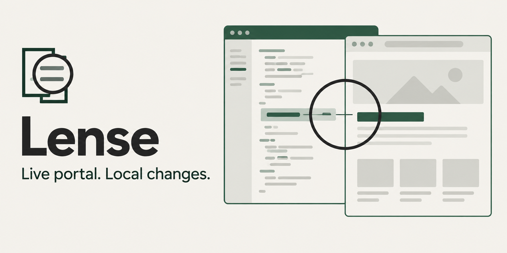

# Lense



Lense lays local JavaScript, CSS, images and supported literal HTML edits from a Power Pages export over a live site in
a dedicated browser. The online backend still runs Liquid and Dataverse; Lense does not deploy, upload or run PAC.
Browser actions use the live site and can affect live data.

For model-driven apps, the
[Solution resource overlay mode](../mirage/docs/model-driven-customizations.md#preview-the-same-code-with-lense) maps
exported JavaScript, PCF bundles and styles to the environment's observed resource paths with the same panel, X-ray,
reload and agent/debugger workflow; its [Actions tab](model-driven-actions.md) adds native inspection and form tools.
Installation and a first catalogue are in [getting started](getting-started.md); settings are in
[configuration](configuration.md).

## Your edit-preview loop

```sh
npx --no-install paqvilo lense doctor --config ./paqvilo.config.yml --site portal --env dev
npx --no-install paqvilo lense dev --config ./paqvilo.config.yml --site portal --env dev
```

1. On the first run, sign in through the portal's own sign-in action with the intended account. The dedicated profile
   keeps that sign-in for later runs ([which browser profile](#which-browser-profile)).
2. Open the panel with **Alt+Shift+P** and check the selected site and environment.
3. Save a supported local change. Affected pages reload; CSS can hot-swap.
4. Check applied resources, **Issues** and failed requests; switch **Online / Local** to compare.

Close the dedicated browser or press Ctrl+C to end the session.

| Change                                                    | What to expect                                                        |
| --------------------------------------------------------- | --------------------------------------------------------------------- |
| JavaScript, CSS or an image                               | Response overlays from discovered source mappings                     |
| Supported literal HTML or inline fields                   | Baseline patches where the match is unambiguous                       |
| Liquid logic, server-side settings or Dataverse behaviour | Still evaluated by the online portal; deploy through your own process |
| Server-side rendering with local data                     | Use [Mirage](../mirage/README.md)                                     |

**Issues** lists changes that need deployment, including a changed source whose inline or markup preview is disabled. A
reload alone does not mean an edit was applied.

### Session behaviour

- The dedicated profile keeps the portal's cookies in `<profile>.session.<hash>.json` beside the profile folder, one
  file per set of portal hosts. Only cookies of those hosts are kept (identity providers on other hosts are not), and
  Mirage staff-selection cookies never are. Removing a profile means deleting its folder and its `.session.*.json`
  files.
- A new tab can load before interception attaches. Lense then repairs a clean initial document with one GET, never
  replaying a form submission. Edited controls or rich-text edits keep the document and raise a reload-needed warning.
  An older repair never replaces a newer navigation.
- Startup reports configuration, source discovery, process ownership, browser/interception setup, document navigation
  and initial requests, with a five-second heartbeat and command-total and per-phase times. A failure names its phase. A
  listening runtime or loaded document does not prove the application is ready: page scripts, sign-in and later requests
  can still be pending. Native model-driven overlays finish startup at document load; Mirage model-driven dev also waits
  for the catalogue, staff identity and initial view.
- `--startup-timeout` (mirage start/dev, model-driven dev; default 120000 ms) is the longest silence without startup
  progress; each progress record and the runtime's discovery file restart it, and 600000 ms is an absolute cap. Source
  discovery and ownership checks run before the runtime starts and count against the same value as a total.
  `mirage start --json` prints its result on stdout and startup events on stderr. Ctrl+C stops pending startup and the
  owned runtime.
- If interception cannot be installed on a newly opened tab, only that owned tab closes (an attached browser shows a
  local failure page). Other tabs, drafts, watchers and agent endpoints keep working; open a fresh tab to retry. Losing
  the shared browser connection ends the session.
- Interactive dev leaves `alert`, `confirm`, `prompt` and before-unload dialogs to the user. Owned headless dev
  dismisses alerts, confirms and prompts and accepts before-unload so navigation completes. Each dialog's type, redacted
  message and disposition appear in Activity and agent events. Attached browsers keep control of their dialogs.
- The **Portal / environment** row appears only when there is another target; **Go** is enabled once a different one
  is selected. Target selection in the panel commits only on Go or Enter. Leaving a local runtime for a live target, or
  opening a `caution` environment, needs an in-panel confirmation; Cancel or a failed switch restores the current
  target. UI state is per browser profile (in memory for a CDP attachment without a known profile). Automated headless
  sessions start collapsed.

### Which browser profile

`dev`, `mirage dev`, `verify --signed-in` and `model-driven dev` choose the browser the same way (catalogue keys in
[configuration](configuration.md); `verify` does not attach). `lense list --site <site> --env <env>` prints the choice
for that selection as `browser profile:` and `user-data root`, with `browser profile cannot be used:` when the selection
cannot launch; `dev` repeats the choice on its `browser` line.

| Option                                                 | Browser                                                                                 |
| ------------------------------------------------------ | --------------------------------------------------------------------------------------- |
| none                                                   | The target's toolkit profile, `<profiles>/<site>-<env>`, isolated from your own browser |
| `--profile <name>`                                     | A named toolkit profile, `<profiles>/named/<channel>/<name>`                            |
| `--user-data-dir <root>` + `--profile-directory <dir>` | An existing profile; `<root>` is the parent of the Profile Path in `edge://version`     |
| `--cdp-url <endpoint>`                                 | A browser you started with a debugging endpoint; Lense attaches to it                   |
| `--cdp-url msedge` + `--profile-directory <dir>`       | Your running everyday Edge (or `chrome`), in the open profile you name                  |

`<profiles>` is `browser.profileDir`, by default `.paqvilo/profiles` beside the catalogue (Chrome and Chromium use a
`default/<channel>/` subfolder). `mirage dev` keeps its own toolkit profile, `<profiles>/<site> Mirage-<env>`.

- Toolkit and named profiles are persistent. A new one starts anonymous: sign in once in the headed Lense window through
  the portal's own sign-in. Lense keeps the portal's cookies in the session file beside the profile folder, so every
  later `dev` or `verify --signed-in` that resolves to the same profile starts signed in, headless runs included. Only
  one browser can use a profile at a time: stop the running session (Ctrl+C or `agent stop`) before another run.
- The profile folder is resolved from the catalogue's location. A catalogue in another folder, such as a scratch copy
  pointing at other sources, gets a new anonymous profile; to reuse a signed-in one, set `browser.profileDir` to the
  folder that holds it and keep the same site and environment names.
- An existing profile is left entirely to the browser: Lense neither restores nor saves a portal session file for it.
  Pointing `--user-data-dir` at a toolkit profile folder therefore does not carry its portal sign-in, even when the
  identity provider still signs the browser in to a private site.
- With an existing profile Lense launches the browser itself, so nothing else may be running on that user-data root;
  otherwise it stops with "the browser profile ... is in use or could not start". Edge's normal user-data directory is
  refused before anything starts ("Edge cannot be automated through launch flags in its normal user-data directory"),
  so an everyday Edge profile can only be used by attaching. A missing root fails with "Existing browser user-data
  directory not found", a missing child with "Existing browser profile directory not found" (`--profile-directory`
  defaults to `Default`). `lense list` reports these; `lense doctor` does not check them.
- `--cdp-url` accepts an `http`, `https`, `ws` or `wss` endpoint; one that does not answer fails with "Cannot attach to
  the --cdp-url browser debugging endpoint". An attached browser stays yours: when Lense stops it detaches and leaves
  the browser and its debugging endpoint running. `--debug-port` cannot be combined with `--cdp-url`; attach your
  debugger to the browser's own endpoint.
- An attached browser opens the Lense tab in the profile whose window was active last, and `dev` prints
  `(last active profile)`. Add `--profile-directory <dir>` to name the profile: Lense opens its tab, reads the profile
  from the browser's version page, and when it is another one brings a tab of each other open profile to the front in
  turn until the tab opens in the named profile. A profile without an open window is refused with "The attached browser
  has no open window of the profile directory", listing the open ones. Tabs of every open profile share the attached
  session, so the overlay also applies to the same portal opened in another profile of that browser.

#### An everyday Edge profile

Edge and Chrome ignore debugging flags on their normal user-data directory, so a profile kept there (for example
`Profile 5` of `%LOCALAPPDATA%/Microsoft/Edge/User Data`) is used by attaching to the running browser:

1. In that browser open `edge://inspect/#remote-debugging` (`chrome://inspect/#remote-debugging` in Chrome) and tick
   **Allow remote debugging for this browser instance**. The page then shows `Server running at:` with an address. The
   setting is kept across restarts.
2. Open a window of the profile. `edge://version` shows its directory as the last part of **Profile path**; the name
   shown in the profile menu is a label, not the directory.
3. Start with `--cdp-url msedge --profile-directory "Profile 5"` (or `browser.cdpUrl: msedge` and
   `browser.profileDirectory: Profile 5` in `paqvilo.config.local.yml`), and answer the browser's **Allow remote
   debugging?** prompt with **Allow**. The prompt appears at every start and Lense waits for the answer.

A channel name (`msedge`, `msedge-beta`, `msedge-dev`, `msedge-canary`, `chrome`, `chrome-beta`, `chrome-dev`,
`chrome-canary`) stands for the endpoint that browser writes to `DevToolsActivePort` in its normal user-data directory.
That endpoint has no HTTP discovery and its port is not always 9222, so `--cdp-url http://127.0.0.1:9222` does not
reach it.

A ticked setting is not proof that the browser serves the endpoint; the `Server running at:` line with an address is.
`DevToolsActivePort` is not proof either: the file stays after the browser closes or the setting is turned off.

- The page stays at `Server running at: starting…` while the Edge flag `edge-devtools-wdp-remote-debugging`
  ("Enable remote debugging over Windows Device Portal" in `edge://flags`) is Enabled, or when the browser was started
  with its own debugging flags. Set the flag to Default and restart Edge. The start fails with "That browser has not
  served a remote debugging endpoint" when it never served.
- A closed browser, a setting that was turned off and a prompt answered with **Cancel** all fail with "The browser is
  closed, its setting ... is off, or its "Allow remote debugging?" prompt was answered with Cancel".

## Commands

Run `npx --no-install paqvilo lense --help` for every option; [command-line usage](cli.md) covers output streams and
exit status.

| Command                | Purpose                                                                                                                        |
| ---------------------- | ------------------------------------------------------------------------------------------------------------------------------ |
| `list`, `use`          | Show targets and settings in effect; remember a site/environment in `.env`                                                     |
| `doctor`               | Check configuration, source mapping, Solution inputs and baseline offline                                                      |
| `map`, `resources`     | Online-to-local mappings; editable source descriptors and metadata relationships (offline)                                     |
| `audit --all --strict` | Inventory export code for every configured environment and fail on gaps, blocked or disabled resources, and source diagnostics |
| `analyze`              | [Offline source analysis](static-analysis.md)                                                                                  |
| `dev`                  | Dedicated browser with local overlays, watching saves                                                                          |
| `status`               | Compare local web files with what the environment serves to an anonymous request                                               |
| `verify`               | Edit a disposable copy and check the browser applies supported changes                                                         |
| `agent`                | Inspect and control a running owned browser ([reference](#agent-api-reference))                                                |
| `model-driven`         | `inspect` or `dev` (default) of exported Solution web resources and mapped PCF bundles                                         |
| `mirage`               | `init`, `start`, `dev`, `status`, `inspect`, `stop` of local [Mirage](../mirage/README.md)                                     |

Use repeated `verify --verify-path /en/ --verify-path /fr/` to exercise multiple pages on one site and environment.
Each page gets a separate disposable source copy and evidence report. The JSON result includes the requested pages,
individual outcomes, and evidence paths. Configured form script kinds that the page does not render are listed as skips.

- `doctor --all --mirage --json` gates on Lense, Sources and Mirage readiness. Without `--mirage` the exit status covers
  Lense only and source diagnostics stay warnings; each site line names all three states. Duplicate exported YAML keys
  fail Sources. `--lint-profiles` also scans every exported `deployment-profiles` directory for JSON/YAML syntax errors
  (`profileDiagnostics`: file, parser code, line, column, bound flag); these are warnings.
- `dev --no-overrides` shows the environment as served, for reference captures. `--scope changed` overlays only files
  that differ from the baseline.
- `map --check` and `status` request every mapped web file anonymously, without the dev profile's sign-in (even when
  that profile is signed in) and without following redirects. A private site redirects each one to sign-in
  (`redirect (HTTP 302)`); both commands then report the check as incomplete and exit 1. For a private site, check
  signed-in application in a `dev` session (agent `state` and `events`) or with `verify --signed-in`.
- `map --no-write --json` returns the mapping without writing reports. `resources` distinguishes `exists`, `empty` and
  `renders` for optional enhanced fields; duplicate active page URLs and overwritten YAML records are diagnosed.
  Resource IDs from `resources` differ from agent page IDs.
- `audit` coverage is source classification, not proof of navigation or browser application. It also checks every
  `codecomponent` tag of the export against the Solution and `pcf.sources` controls, with the rules of the Power Pages
  Liquid host: a quoted name (`PCF_AUDIT_NAME_QUOTED`), a control GUID in braces (`PCF_AUDIT_NAME_BRACED`: the platform
  halts rendering there and cuts off the rest of the page; upper-case and hyphenless ids render), a second tag of the
  same control in one file (`PCF_AUDIT_DUPLICATE_CONTROL`), a control the sources do not hold (`PCF_AUDIT_CONTROL_MISSING`, also a GUID without
  an `observed.codeComponents` mapping), a control the host refuses (`PCF_AUDIT_CONTROL_REFUSED` with its `reasons`),
  the import diagnostics of a referenced control and the `pcf.sources` diagnostics. Each is a warning that leaves the
  audit incomplete, and the report's `codeComponents` counts the tags, the controls read and the findings. With
  `--strict`, an export that uses `codecomponent` tags therefore fails until `mirage.solutionRoots` or
  `mirage.pcf.sources` holds those controls. Tags in `` and `` blocks are skipped; a tag without
  a name is counted but not checked. An unreadable export file is `PCF_AUDIT_EXPORT_UNREADABLE`, and a failure of
  these checks is `PCF_AUDIT_FAILED`, never a site error.
- `audit` resources and `verify` `diagnostics.baseline/afterEdits.needsDeploy` rows carry the same `deploymentCode`
  for the same condition: `server-logic`, `site-metadata`, `deployment-profile`, `portal-metadata` (a record field the
  overlay does not apply), `inactive-record`, `unresolved-page-url` and `preview-disabled` (an audit resource of a
  mapped kind that the site settings do not enable). Only `verify` reports changes against its baseline:
  `record-lifecycle` (a created, deleted or unindexed record), `new-source`, `liquid-change`, `unlocatable-change`,
  `unreadable-field`, `component-metadata-unparsed` and `pcf-manifest` (also an edited `img` or `html` resource,
  which the page never loads); `audit` reports unreadable sources as errors and code components in `codeComponents`.
  A needsDeploy row whose reason no kind matches has `deploymentCode: null`.
  `test/deployment-diagnostics.test.mjs` checks both commands against this list.
- `analyze` reports `PP-CACHE-001` (warning) when `Header/OutputCache/Enabled` or `Footer/OutputCache/Enabled` is
  literally true and the website's Header or Footer web template, or a template it includes by name outside a
  substitution block, reads `request`, `params`, `page`, `now` or `language.url` outside
  `...`: the cached output is reused for other requests
  ([output caching](https://learn.microsoft.com/power-pages/configure/enable-header-footer-output-caching)). `user`, the
  `*_substitution` attributes and names the template declares in scope (`assign`, `capture`, `for`/`tablerow`
  variables, include parameters) are not reported; `.url` of a `website.languages` loop variable is. An absent,
  unresolved or duplicated setting reports nothing.
- `analyze` reports the Power Pages limits of a PCF manifest: a required `uses-feature` (`APP-PCF-013`, warning), a
  declared Device capture, location, barcode or file API or Utility (`APP-PCF-014`), a bound type outside the Power
  Pages field types (`APP-PCF-015`; a type group passes when one of its types is supported), more than one bound
  property (`APP-PCF-016`) and a `dependency` resource (`APP-PCF-017`), the last four as hints.
- `verify` edits the page script and style of the page copy in the language the browser displays, taken from the page
  that the start path finally showed.
- Lense reads an enhanced site's site and language records only from `Assets/` (or the root) of the folder that holds
  `powerpagecomponents/`, as Mirage does. A component file whose envelope cannot be parsed (for example a character
  reference outside Unicode) is skipped and the rest of the Solution loads.
- `verify --signed-in` reuses the dev profile and its sign-in: close that dev session first. When the profile is already
  signed in it also runs headless; add `--headed` when a sign-in may still be needed and bound it with
  `--sign-in-timeout` (1–900000 ms, default 900000). Each check reports `ok` `true`, `false` or `null` (skipped, with
  the reason in `detail`, such as a page without an image web file); a run with skips passes with coverage `partial`.
  The report also names `inlineBaseline`, diagnostics before and after the edits, and `cleanup`
  (`temporarySourceRemoved`). A sign-in page is never counted as target coverage: an anonymous
  run on a private page fails with `<path> needs a sign-in (ended on <sign-in URL>)` and prints the rerun command with
  `--headed --signed-in`, and a missed deadline fails with `Sign-in did not complete within the configured deadline`.
  Both report `errorCode` `VERIFY_FAILED`, coverage `incomplete` and exit status 1 after removing the temporary copy.
  An interrupt (Ctrl+C, SIGINT, SIGTERM) ends the run with `errorCode` `VERIFY_INTERRUPTED` and exit status 1 after
  closing the panel, interception, watcher and browser and removing the temporary copy (kept when `PAQVILO_KEEP_TEMP`
  is set). A second signal is absorbed; a third writes `Forced exit: cleanup did not finish.` and exits 130 (SIGINT) or
  143 (SIGTERM).
- `mirage start` refuses settings that differ from a live runtime owning the same state file, naming its pid and file;
  stop it or pass `--state <other file>`. A runtime recorded on another host (Windows and WSL, or runners sharing a
  checkout) is never listed, selected, pruned or signalled here, and a start on its state file is refused; when that
  host no longer runs it, delete its entry from the ownership file the message names. `mirage stop` exits 2 only for a
  selected runtime of this host it could not verify. `mirage status` and `mirage stop` select runtimes by the
  [scoping rule](../mirage/docs/toolkit-integration.md#which-runtimes-status-and-stop-select). If `mirage dev` is
  killed instead of closed, its browser closes but the runtimes it started keep running: `mirage status` lists them and
  `mirage stop` stops them. Each `mirage` action accepts only the options its `--help` lists; another fails with
  `--<option> is not supported by mirage <action>`. Interactive `mirage dev` rejects `--json`; use `start` plus the
  agent API for automation.

### JSON envelope

Lense `--json` output is `{ schemaVersion, command, ok, offline, writesFiles, errors }`, where `writesFiles` lists files
actually written and `errors` holds `{ code, message }` objects; a failure also carries its primary error as `error`.
Generic codes are `invalid_argument`, `unsupported_option`, `unknown_command`, `configuration_error`, `command_failed`
and `check_failed`; strict inventory failures use `strict_failed` with blocked/gap counts. `status` and Mirage
`status`/`start`/`stop` set `offline: false`; `status --json` fails when a comparison is incomplete. `verify --json`
reports its result after cleanup. `mirage init` names its project file, writes `--solution-root` as its Solution roots
and carries `--state`, `--port`, `--preset` and `--preset-mode` into the `dev` command it prints; `start` names state,
discovery, ownership and startup log files; `stop` names the updated ownership file and reports removed discoveries
separately. `lense mirage inspect` is offline and writes nothing.

## Source mapping and comparison scope

JavaScript, CSS, images and inline fields map from discovered export metadata; literal markup uses baseline patches and
rejects ambiguous matches. Enhanced XML and code-bearing YAML fields are edited through their discovered field/JSON
descriptors: [`lense/source-edit.mjs`](../lense/source-edit.mjs) preserves sibling values and rejects stale identity or
paths outside the export.

HEAD is pinned as the baseline when a target activates, so a later commit does not erase it; an explicit `--baseline`
ref stays explicit. The panel reports Git drift and can pin a fresh HEAD. Create the initial source commit before
previewing literal markup; this local baseline does not identify the deployed commit. Without a baseline (sources
outside Git, a repository without commits, or a `--baseline` ref that is not a commit) the panel header shows **No Git
baseline** and **Issues** lists **Comparison unavailable** with the reason and what to change; its copy button copies
Git's own message. Shared sources reload the affected portal's tabs, page sources that page. Pausing reload preserves
an unsaved form while saves accumulate.

### Code sites (single-page applications)

When the source is a code-site project (`powerpages.config.json` beside its `.powerpages-site` folder), Lense lays
the local build over the live site, as `pac pages upload-code-site` would deploy it:

- A file of the build (`compiledPath`) answers its own address ahead of the exported web file at that address; a web
  file the build does not hold is still answered from the export. The landing page's own address (`/index.html`)
  answers the local file.
- An application route (an address without a file extension, outside the portal's own paths) is asked from the
  portal, which answers it with the site's root page
  ([Learn](https://learn.microsoft.com/en-us/power-pages/configure/create-code-sites#differences-from-existing-power-pages-sites)).
  Lense lays the local landing page over the deployed one by lines: what the portal added to the deployed landing
  page (its client context, `Microsoft.Dynamic365.Portal` with `isSpaSite`, the anti-forgery holder) stays, and the
  build's changes replace the lines they change.
- The deployed landing page is the exported web file at its address, so download the site
  (`pac pages download-code-site`) before you change the build. The page then names why the local landing page was not
  laid over: the export has no deployed landing page, the portal answered the route with another document, or the
  portal and the build changed the same line (deploy to see that change).

The source watcher also watches `powerpages.config.json` and the build folder it names, also before the first build
creates it: a rebuild reloads the open tabs with the new build. A configuration Lense cannot use (a `compiledPath`
outside the project, a missing landing page) is reported once as a session fault and the export alone is overlaid.
How the hosted platform composes the root page has not been captured yet; the line merge follows the documented model.

### A checkout ahead of the portal, or behind it

Lense lays over a page the difference between the baseline and your working copy, and takes the baseline for what the
portal has. That does not hold when you check out a development branch whose commits are not deployed (ahead), or an
older branch or release against a newer deployment (behind). Lense checks it on every page: the response as the portal
sent it is compared with the baseline's version of each template, snippet and page copy, between two tags of the file
found in the page with no Liquid code in between that prints. What the two do not have in common is reported per file
and place: **only in the served page**, **only in your file** or **differs**.

- Overrides lists **Served in another version than the baseline** with the places on the open page, and a banner counts
  the files. The terminal prints one `NOTE` line, and `agent status` carries the same under `served`
  (`baseline`, `differs`, `deployed`, `files[].pages[].places[]`, `search`).
- Lense then asks Git which version the pages show: the file's earlier commits, and the branches and tags that hold such
  a version of every differing file (`served.search.refs`). When one is found the banner offers **Compare with
  \<ref\>**, which is `--baseline <ref>` without a restart: the whole difference between that ref and your checkout is
  laid over the portal, so a branch that is ahead shows its undeployed work and an older checkout shows the older
  version. This compares only what the opened pages show of those files; it does not name a deployment. The newest 40
  versions of a file and 400 branches and tags are compared; the banner says when Git could not be asked or when that
  was only part of the history. From the page only a ref found this way can be chosen; any other baseline is set with
  `--baseline`.
- When no version in the repository is what the portal serves (deployed from elsewhere, edited in the studio, or a
  component the portal renders from its own copy), the list says so and nothing is laid over those places.
- A changed file whose working copy the portal already serves (uploaded, not committed) is marked **already served** and
  is not laid over a second time.
- X-ray names an element the served page has and your file does not as **Not in your local copy of this file**, at the
  place it would stand, and marks every source row of such a file with **The portal serves another version of this
  file than your baseline**.

A change on a line that also holds Liquid code is laid over by position: where the page shows the file's markup between
two of its tags, the file's text goes there. Text right beside what Liquid code prints, and a change to the Liquid
code itself, stay under **Needs deploy**. The portal closing an element a template leaves open is not a difference.

Panel keys: **Alt+Shift+P** panel, **Alt+Shift+L** hide/show, **Alt+Shift+O** Online/Local, **Alt+Shift+X** X-ray;
**Esc** closes a comparison, then clears the filter, then collapses the panel. When the environment is the site's own
local Mirage (a loopback origin on the port in `sites.<id>.mirage.port`, or on Mirage's default port 8787 when the site
sets none; `mirage dev`; or a model-driven `--local-simulation`), the panel has no **Local**/**Online** switch and
Alt+Shift+O does nothing: Mirage already serves your local sources. Started with `--no-overrides` there, the banner's
**Back to local** still turns the overrides on. X-ray turned on from the open panel takes its place; turning X-ray off
brings the panel back on the same tab. **Inspect** works for live and Mirage sessions; **Tweaks** changes local Mirage
identity and scenarios; **Mirage** (under `mirage dev`) shows the runtime, its diagnostics and content policy, and opens
the Mirage admin pages for the current page. Targets stay isolated by origin, environment and source selection.

The panel, X-ray and the model-driven panel follow the operating system's light or dark colour scheme, whatever the
page's own theme.

In **Tweaks**, the first line says who this browser is; its tooltip says how the portal signs in. A signed-in contact
whose web role has the **Preview Unpublished Entities** website access permission also gets a **Publishing preview**
On/Off switch, the classic Enable and Disable preview; switching it reloads the page
([publishing preview toggle](../mirage/docs/sim-administration.md#publishing-preview-toggle)). Each persona row
signs this browser in through the portal's own sign-in (other browsers keep their sessions); its star makes it a
favorite, listed first under **Favorites** in this browser. The persona this browser is signed in as is marked
**signed in**, and **Activity** logs each sign-in and sign-out when it starts and when it finished or failed. **/**
focuses the persona search and **Esc** clears it. The filter button beside the persona search opens web role, tag,
account and group chips, each facet with the same **any** chip (personas with any value of it); the next button opens
the full picker in Mirage admin.

In **Overrides**, **Local files: all | changed vs Git** chooses which local files override the site (the same choice as
`dev --scope`; switching reloads the page). A row says **differs from deployed** or **same as deployed** when Lense
compared it with the version **Online** shows (in front of a local Mirage: **differs from served version** or
**unchanged**), and **N requests** when the page requested it more than once. A source-map comment
(`/*# sourceMappingURL=... */`, `//# sourceMappingURL=...`) that only the served copy has is no difference, in the
row and in the comparison (**local vs deployed**, or **local vs served**). The filters and the scope switch sit under
the search box. While the page uses no local file they are hidden, unless **changed vs Git** is on; a filter with
nothing to show is hidden, and without a Git baseline **Edited** and **changed vs Git** are not offered. The footer
counts what is laid over the site, so a paused override leaves it. Every file row, on every tab, opens its file with a
click on the row and copies its path with the copy button; a page or address row navigates with the arrow button.
The first column names a row's kind in words (Template, Snippet, Script, Style, Table, ...), with the full name in the
tooltip, unless the row's own name already says it. A Solution file named by an ID shows `{…}` in its place
(`FormXml/main/{…}.xml`); the full path is its tooltip and what Copy copies.

**Page requests** lists every request of the open page by where its answer came from: **From your sources**,
**Pages**, **In your sources, not laid over** (under Mirage: **Served by Mirage**), **Portal data**, **Portal runtime
files**, **Other sites** and **Not identified**, each with its count. A row of your sources that was not laid over
says why (the scope is changed vs Git, the override is paused, a route passes it to the portal, several web files have
the address, only reads are laid over, ...). A code component bundle or style sheet (`/_pcfwebresource/<id>`) and a
Solution web resource (`/_webresource/<name>`) are served from your Solution roots, or from a `mirage.pcf.sources`
build output, when the page declares them and the sources hold the file (a control of a Solution ZIP is not laid
over). Each kind (bundle, style sheets) maps on its own: when your manifest declares other style sheets than the page,
or gives them different `order` values, those go to the portal while the bundle is still laid over. Such a
difference, or a parameter the page declares that your manifest no longer has, is listed in **Issues** under **Needs
deployment or a source fix**; the control is passed to the portal only when no kind maps. A manifest `img` or `html`
resource is never laid over: Power Pages declares no resource entry for it, `getResource` fails and
`/_pcfwebresource/<id>` answers 403, so a local edit of one (a save, or a file Git reports as changed in its Solution
repository) is listed there too, saying that it cannot be previewed and does not reach the page when deployed. The
button on a row selects the element that loads the file. **Differs from deployed, not applied** lists page blocks that
differ from your file and are not laid over, with the reason on each row.

In **Inspect**, the icon buttons beside the filter refresh the inspection, select an element and expand or collapse
every group; the section chips sit on one line under the filter. **Page & templates** covers page copy, scripts,
styles and template dependencies; **Forms & controls** joins exported forms, lists, views and fields to rendered
controls. Selecting an element picks a node without activating it; its details open under the section chips, headed
by its kind and name as in X-ray, and scroll with the tab; on the other tabs they stay folded under that header. The
locate button of a field or control finds it on the page; the Mirage button opens its record or setting in Mirage
admin. A content snippet of markup reads as a summary (**HTML · 1 line · link**); its value is the tooltip and has
its own copy button.
**Tables & access** shows the table permissions, scopes, relationships and web roles of your sources, each operation
as a word (**read**, **no create**, **update, scoped**) and each reason once; an exported grant does not prove the
signed-in user can use it, and on a live portal Inspect says that web-role membership is not known.
Components are named, never shown by ID; **Rendered controls without a source** lists each control that matches no
source or several, with its locate button. **Check identification** asks X-ray about every element of the page and
counts the answers (identified, inside an identified element, likely, in conflict, not identified), with the
elements that have no answer listed for selection; `paqvilo lense agent coverage` returns the same counts. A banner
says when Inspect read only part of the page or of your sources.

With only a portal export, Inspect resolves portal components, snippets, web files and access rules. Add
`mirage.solutionRoots` or `mirage.project` to resolve Solution FormXml, views, table fields, PCF manifests/resources and
literal dataset bindings (live Lense reads them without starting Mirage). Table rows also show exported plug-in
registrations (message, stage, rank, filtering columns, type, assembly) and open their XML or
[mapped C# source](../mirage/docs/dataverse-plugins.md); they do not establish which assembly is deployed. Refreshing
the inspection rereads the sources.

### Selection evidence

The panel and X-ray show one evidence summary. **Component** is the component identified for the selected node, with
its own file; **Source file** lists the other files that define or render it. **Contained in** lists the form, table,
basic form and web page around it; each one with a local definition opens it in the editor or copies its path, like the
component and source rows (a web page opens its `.webpage.yml` record). Each row has its own state: **Exact**,
**Likely**, **Conflict**, **Not found** or **Outdated**; hover the badge to see what it means for that row. An exact
component can have an outdated or missing source, and local matching never establishes the deployed revision.
**Other possible matches**, **Context** and **Search limits** appear only when they have something to show. A declared
dependency, matching selector or top-ranked match does not prove ownership; for an asset the row says what was seen on
the page: **Loaded by this page**, **Ran on this page** or **Mounted on this page**. In the panel, each row shows the
component's name, kind and certainty; the X-ray card names the selected component in its header (display name ·
logical name) with its badge. The relation (for example "The view shown here") is the row's tooltip; screen readers
announce each badge's meaning.

On a live portal every element of a page gets an answer. Lense aligns the page the portal sent with the markup of
your export (web templates, content snippets, page copy and summary, web link set copy, site setting values, form
instructions) tag by tag, and X-ray reads the result:

- **Found at this place in the served page**: the tag is the file's own tag, at that line. A tag with Liquid code
  inside it is the template's tag with the values the portal wrote.
- **Generated by this Liquid code**: the element stands where a Liquid tag or output of the file wrote it (a form or
  list tag, an include, an editable region, a loop); the row opens that code.
- **Loaded by this element**: a web file of your sources, a code component file of your Solution, a portal runtime
  file or a file of another site, named by the address the element loads.
- **Added by the portal around your templates**: the page shell (document, head, the portal's own scripts and bars).
- **Inside a known element**: an element a script created at runtime is named by the identified element it stands
  in, with the script that made it when that was observed.
- **Not in your local copy of this file**: the served page holds a tag where the file holds none, because the portal
  serves [another version](#a-checkout-ahead-of-the-portal-or-behind-it) of the file.

A source is named only by a sequence of its markup that no other source explains as well; short markup that merely
looks the same (a link of the header inside a menu, the portal's own breadcrumb) is not attributed, and a template
the page does not reach needs a long sequence. Markup two sources hold alike is a **Conflict** that lists both; the
same markup in several places of one file names the file and says that the line is one of several. Under Mirage the
same answers come from the local render itself.

Rules that decide attribution:

- **Power Pages fields** read **column → Solution form (FormXml) → table → basic form → host webpage**; each level keeps
  its own state, the host page is context only, and a missing definition stays unavailable rather than borrowed from
  another form or table with the same field name.
- **Native list/subgrid modals** with an all-zero layout form ID resolve through the same-origin `data-page` frame,
  modal action class, an independently identified opener (a rendered list or subgrid ID, or a referenced list whose view
  matches the grid) and its exported action form. Only a unique consistent join sets the form; otherwise the rendered
  table and the declared action forms on it stay candidates. An all-zero form ID never identifies a form by itself; a
  unique verified basic-form wrapper can.
- **Script-created elements** link to local code through an observed callsite, labelled **Created by this script**,
  **Copied by this script** or **Inserted by this script** with the file, line and column, only when the acknowledged
  response bytes and the parsed script version agree. Code a script evaluates reads **Created by code that this script
  evaluated**; a call through a helper your sources do not hold names the caller; a script of another site or of the
  portal is said to be that. Custom stack formatting and ambiguous versions stay unavailable. An element a script
  creates is answered by the identified element it stands in, with the script as a row. Rows, cells, captions, heads
  and options that a table or select call makes (`insertRow`, `insertCell`, `createCaption`, `select.length = n`)
  are created by that line; an element a constructor makes (`new Option()`, `new Image()`) is inserted by the line
  that puts it into the page. An option assigned by index (`select.options[2] = option`) has no call to observe: X-ray
  names the select it stands in and no line.
- **Script-changed elements** stay what the template wrote. An element of the served page that a script moves keeps
  its template line and gains **Moved by this script**, also when it travels through a document fragment, inside a
  wrapper the script builds first, out of a range, or by `moveBefore`; one whose attributes, classes, style, data
  attributes, value, text or children a script changes gains **Changed by this script: \<what\>**, newest first, with
  file and line when the call was observed. An element whose `id`, `name` or `type` (or a data attribute that names a
  table, form, view, list or control) a script changes is repurposed: it loses its template line and reads as an
  element inside the template markup around it, with no source of its own; its **Changed by this script** rows stay.
  A copy a script makes of a template element (`cloneNode`, `importNode`) is never the template's element. A change
  with no call to observe (`el.style.color = …`, `el.dataset.x = …`, code another script runs inside the call) reads
  **Changed without a recorded script call** and names no script: `style` and `dataset` stay the browser's own
  objects. A look-alike a script renders in place of template markup is the script's. The record is bounded (2,000
  elements per call, 5,000 recorded calls per task, four rows per element); past a bound the row says the script was
  not recorded and no script is named.
- **Sign-in pages** reach the browser exactly as the portal sends them: Lense reads and marks nothing on them, so
  X-ray matches their elements by markup only and says so.
- **Marks.** Lense marks each element of a page it has compared with one random `data-paqvilo-source` value and
  removes it as soon as the element is known; a page's own change observers are not told about it. Code that runs
  while the parser inserts an element (a custom element's callbacks) can still read that one value; it names nothing
  else and cannot be used to forge or revoke an answer.
- **Liquid conditions, loops and includes** on a live page: each row of a loop is the loop body's line, a rendered
  branch is its own line, a partial included several times names its line with each include tag as context, and what
  an output or a form or list tag prints reads **Generated by this Liquid code** (for one tag: **Generated by the
  \<tag\> tag**). Where the served page cannot show which of several identical places wrote a tag, the row says it is
  one of them. Under Mirage a form or list also names the tag that rendered it, and a printed snippet the output that
  printed it.
- **Custom grids** declare bindings with `data-paqvilo-table="logical_table"` on the table and
  `data-paqvilo-column="logical_column"` on cells or headers; DataTables column `name` (`sName`) is read without running
  renderers. A scroll-head clone can point at its grid with `data-paqvilo-grid="original-table-id"` and
  `data-dt-column`. A unique declared pair joined to an exported column gives its **definition** source, not the
  renderer or record. Nothing is inferred from API requests, cell contents, neighbouring grids or the containing form.
- **Frames**: accessible same-origin frames (nested, inserted or navigated later) and modal iframes are inspected with
  their own form and table context. Native quick-view iframes join a verified parent form and that control's QuickForms
  target. Rich-text editor frames inherit a field binding from attribute-scoped hosts (`<logical_column>_ControlView`,
  `<logical_column>_Container`) joined to a verified form, up to 16 frame levels or 256 ancestors. Cross-origin and
  sandboxed frames and closed shadow roots are boundaries; URL parameters are context, never proof. Selecting such a
  frame says it is outside Inspect, and **Not everything was read** counts the frames the page read could not enter.
  A closed shadow root cannot be detected from the page, so it is not counted.
- **Code components** link FormXml properties and bound columns to manifests and portal settings, distinguish the
  desktop control from other form factors, and report portal enablement separately. Constructor and mount details appear
  only when observed.
- Field identifiers are checked against the selected export and table context; ambiguous matches stay candidates.
  Matching uses static IDs, classes and component attributes, not positional DOM paths. Classes are weighted by rarity,
  so common framework classes stay candidates. Static Liquid matching cannot prove which branch rendered.

The open button of a row (its accessible name is "Open <row> in editor") rechecks the selected node, source identity and
revisions before opening; outdated, conflicting and missing files cannot open, and the button's tooltip says why.
Saving the file while the browser check is pending makes the action outdated: refresh inspection and select again. The
copy button copies the displayed reference; **Markup matches** and its **Open in editor** buttons are suggestions, not
attribution. The inspector never reads input values or page text, and
notifications use opaque document, frame and anchor identifiers.

The picker keeps the selected node while X-ray is hidden; if the node is replaced, its frame navigates or its shadow
host disappears, the selection clears instead of moving to another element. **Clear selection** removes it explicitly.

#### X-ray

Toggle X-ray with the target button in the panel header or **Alt+Shift+X** (also from inside an accessible same-origin
frame). An outline's colour comes from the element's evidence, as the legend says: **Markup from your sources**,
**Generated by Liquid**, **Forms, lists & fields**, **Added by the portal**, **Created at runtime** and **Not
identified** (dashed). While Inspect mode is on, keyboard and pointer activation is intercepted in the page, accessible
same-origin frames and open shadow roots. **Tap Ctrl** (alone) or click **Inspect** to switch to Interact and back;
holding Ctrl no longer interacts. When focus moves into a cross-origin or sandboxed frame, X-ray reclaims it one task
later, so one keystroke can reach that frame.

A hover summary appears beside the element, left of it when there is room, else right, below or above; it hides over
the selected element while its card is open, and wherever it would cover the card. An element with no matching
component says so; picking it opens **Parent elements**. In a narrow window the card is 45% of the window wide, but at
least 340 pixels, and as tall as the room beside the element allows; it scrolls inside when a section grows. Outlines
leave the Lense pill and panel uncovered, and the legend hides while either is under it. **Details** shows the card; off
leaves hover summaries only.

The details card opens beside the picked element (right of it, else left, below or above), inside the window and
above the legend, and follows it on scroll and resize; it covers the element only when no side has room. The **Move
details to the other side** button or dragging its header keeps it where you put it until the next pick. Card controls:
**Parent** and **Child** (also the Up and Down arrow keys), **[ / ]** to cycle overlapping elements, **Reveal**,
**Details**, **Tab / Shift+Tab**; **Esc** clears the selection, then turns off X-ray. Context and
permission lists page eight entries at a time. X-ray is removed when the session detaches.

Limits: a markup source above 1,048,576 UTF-16 code units is skipped and reported; outlines are searched among the 800
elements in view and 250 are drawn per view (scroll or zoom in for the rest; the legend says when a view is cut);
details show up to 60 source matches. Selection still inspects the element under the pointer, **Parent** and **Child**
reach `<head>` resources and hidden parts. **Search limits** reports omissions, and the agent API reports them in
`elementSourceLimits`. Inspection reports are cached until sources change; a refresh rescans source stamps and reimports
a changed export, so its time grows with export size.

## Automation and evidence

Projects with a [persona catalogue](../mirage/docs/persona-catalog.md) can search personas and scenarios in the panel.
Live Lense selection uses the portal's own sign-in flow; it never issues native tokens for a synthetic contact. In
Mirage, scenarios open isolated local setups. **Apply scenario** asks for confirmation in the panel. Keep live identity
mappings and scenario tests in the project.

Agent discovery files contain bearer tokens and stay under ignored `.paqvilo/agents`; never print or share them. A
session removes its file when it stops or its process ends on SIGINT, SIGTERM or SIGHUP. A file left by a killed process
names its owner process: agent commands reject it as `session_stale` without contacting its endpoint, `agent sessions`
lists it as unreachable, and the next session start in that state folder removes it.

After a refresh, inspect applied resources, unmatched markup patches, deployment requirements, errors and failed
requests. Contributors can measure X-ray latency on synthetic exports with
`node scripts/benchmark-xray.mjs --samples 3 --strict --json` in a toolkit checkout.

## Edge controls of the live site

The hosted edge applies site visibility, the web application firewall (WAF) and IP restrictions before a request
reaches the site. They are not in the export, and a local Mirage runtime does not apply them
([HTTP transport and CORS](../mirage/docs/http-headers.md#edge-controls-that-mirage-does-not-emulate)). A project script
reads them for one site with `readPowerPagesEdge` from `paqvilo/dataverse`:

```js
import { readPowerPagesEdge } from 'paqvilo/dataverse';
const report = await readPowerPagesEdge({
  environment: '<environment GUID or HTTPS origin>',
  id: '<management site id>',
});
```

It runs only the read-only PAC commands `power-pages get-website-by-id`, `get-waf-status`, `get-waf-rules` (custom and
managed) and `get-allowed-ip-addresses`, with the PAC executable and environment rules of the other Power Pages
management readers ([project extensions](project-extensions.md)). It changes nothing on the site, and PAC keeps the
sign-in, so no token passes through the report. The report holds:

- `siteVisibility`, and `local.siteVisibility` with the `observed.siteVisibility` value that models it in Mirage.
- `firewall.status`, `firewall.customRules.rules` (name, priority, state, action, rule type, rate limit and match
  conditions) and `firewall.managedRules.ruleSets` (rule set type, version and action, with counts of overrides and
  exclusions).
- `ipRestrictions`: the allow-list entries in CIDR notation. `restricted: false` means that every address may connect.
- `local`: what Mirage emulates of each control. IP restrictions and WAF rules are not emulated.

Match values are reported only for client addresses, request methods, request URIs and country codes. For headers,
cookies, query strings and bodies only the count is reported, because such values can be shared secrets. A read that
the service refuses, such as WAF on a trial site (HTTP 400), appears as `{ available: false, reason, status }`. PAC's
error text is withheld.

## Agent API reference

`paqvilo lense agent <action> --json` (the action defaults to `sessions`; output is always JSON). Every action except
`sessions` needs `--session <discovery file>`; `state`, `snapshot`, `screenshot`, `viewport`, `navigate` and `reload`
also need `--page-id` from `agent pages`. The API is confined to the session's portal origin and has no evaluation,
form-action or proxy endpoint. Agent envelopes add `action` to the [JSON envelope](#json-envelope).

`--timeout` (2000–120000 ms, default 35000) is the action deadline sent to the server; the client waits 30000 ms longer
before reporting `request_timeout`. The server bounds snapshot, screenshot and viewport by the same value (default 60000
ms when absent, at most 120000 ms) and navigate and reload at most 60000 ms (default 30000 ms); a timed-out navigation
is stopped.

### agent sessions

Optional `--config` selects the state folder (`.paqvilo` beside the catalogue, else `.paqvilo` in the working directory)
and lists its `agents/` discovery files. Probes at most 64 discovery files, four at a time, each within `--timeout`.
Returns `sessions` (`id`, `pid`, `site`, `environment`, `startedAt`, `portalOrigin`, `sourceDir`, `discoveryFile`,
`reachable`, `error`), `invalidFiles` and `truncated`; never tokens.

### agent status

Returns the session (without token), readiness, browser scope, access counts, debugger port, baseline, Git state,
`served` (files the opened pages show in [another version](#a-checkout-ahead-of-the-portal-or-behind-it) than the
baseline, with the refs that explain them), overlay, pages and truncation flags. While the tab is away from the portal
origin (for example on the sign-in page) `pages` is empty, `access.externalTabCount` counts the tab and page routes for
it answer `404 page_not_found`. A [model-driven](model-driven-actions.md#targets-and-agent-sessions) session instead
reports `inspection.suspended: true` and answers `409 session_suspended`. A model-driven status has no access counts,
baseline or Git state; it reports `kind`, `browserScope`, `overlay` (revision, applied counts and resources) and
`inspection`.

### agent pages

Returns pages with `id` (a numeric string, passed as `--page-id`), `documentId`, sanitized URL, viewport,
`reloadAllowed` and `documentMethod`. Closed and foreign-origin pages are excluded.

### agent events

`--after` (sequence, default 0) and `--limit` (1–500, default 100). Returns `sessionId`, `events`, `oldestSequence`,
`latestSequence`, `nextSequence`, `dropped`, `hasMore` and `cursorAhead`. Continue from `nextSequence` and check
`dropped`/`hasMore`; a cursor ahead of `latestSequence` sets `cursorAhead` and resets `nextSequence`. Compare
`sessionId` before reusing a cursor. The server keeps 500 events or 1 MiB, whichever is reached first.

### agent state

Returns page, overlay, resources, diagnostics, runtime (the document's last 100 page errors, console messages and failed
requests, with event retention) and limits for the current document. Lists stop at 200 items with truncation flags. A
model-driven session returns the overlay revision, applied counts, resources, diagnostics, problems, the exported form
catalogue, native context and runtime instead of the `overlay` and `limits` objects.

### agent snapshot

`--selector` (CSS, at most 1,000 characters), `--limit` (1–200, default 100), `--styles` (comma list, at most 20
computed properties). Returns sanitized URL, title, total, truncated and elements with tag, bounded attributes/text,
visibility, rect and style. Field values are never copied. An invalid selector returns `invalid_selector` (400).

### agent screenshot

`--output <new.png>` (required), `--full-page`, `--include-panel`. Returns `path` and `bytes`; `writesFiles` names the
PNG. Paths are forward-slash and relative to the catalogue directory (or working directory without `--config`), keeping
`../` segments outside it and only the file name on another volume. An existing file is never overwritten
(`invalid_argument`). Images are limited to 8 megapixels, 8,192 pixels per side and 8 MiB (`image_too_large`).

### agent viewport

`--width` (320–4096, default 1440), `--height` (240–4096, default 900). Returns page and viewport.

### agent coverage

`--limit` (1–50000 elements, default 20000), `--samples` (0–200, default 40). Asks every element of the page, of its
accessible same-origin frames and of open shadow roots what a selection is asked, and returns `page` and `coverage`:
`total`, `truncated`, `counts` (`direct`: the element itself is identified; `contained`: it stands inside an identified
element; `likely`; `conflict`; `none`), `kinds` (how many elements each kind of answer names) and `unidentified` (the
tag and tag path of up to `--samples` elements that are not identified). Tags only: no text and no attribute values. A
session without the dev panel answers `coverage_unavailable` (409).

### agent navigate

`--path <portal path>` (required). Performs a GET on the portal origin and returns page and HTTP status. Other origins
return `foreign_origin`; a redirect off the origin returns `origin_changed`; a browser timeout returns `action_timeout`
(504).

### agent reload

Returns page and status. Only an observed GET document with no pending navigation can reload; unknown, restored-history
and POST documents return `unsafe_reload` (409). Reload issues an explicit GET so a form post is never repeated.

### agent stop

Returns `stopping: true`. Targets that share one toolkit-owned browser stop together: the browser closes and every
associated discovery file is removed. Other sessions and attached user-owned browsers are not touched.

### Agent error codes

Client: `session_not_found` (no discovery file), `session_stale` (owner process gone), `invalid_session`,
`session_unavailable`, `request_timeout`, `invalid_response`, `response_too_large`, plus the generic CLI codes. Server:
`invalid_argument`, `invalid_selector`, `invalid_json`, `invalid_url`, `body_too_large`, `content_type`, `unauthorized`,
`browser_request`, `foreign_origin`, `origin_changed`, `not_found`, `page_not_found`, `method_not_allowed`, `page_busy`,
`session_busy`, `session_suspended`, `coverage_unavailable`, `unsafe_reload`, `image_too_large`, `response_too_large`,
`action_timeout`, `action_failed` and `stopping`. HTTP failures keep their status in the error object; messages omit
browser stacks, ANSI controls and call logs.

## Local source debugging

Mirage appends file-backed source maps to served JavaScript and CSS (including extensionless payloads of those types and
model-driven Solution client resources). Page, template, list and form custom JavaScript carries its export `sourceURL`
and a line-offset map; inline blocks get stable `?inline=N` URLs whose maps point at the export file. Attach VS Code to
the port of `paqvilo mirage dev --debug-port 9222`:

```json
{
  "type": "msedge",
  "request": "attach",
  "name": "Paqvilo Mirage",
  "port": 9222,
  "resolveSourceMapLocations": ["**", "!**/node_modules/**"]
}
```

The maps contain absolute file URLs, so no `pathMapping` is needed; set breakpoints in the export files. Sidecar files
and YAML literal blocks keep their lines; folded or escaped fields and enhanced XML/JSON get a `sourceURL` only. Liquid
that changes line counts shifts later locations: the debugger shows rendered JavaScript, not Liquid execution.

For byte-for-byte asset comparisons set `mirage.sourceMaps: false` (or `sourceMaps: false` in a Mirage project) and
restart. The top-level `sourceMaps` and `PAQVILO_SOURCE_MAPS` control Lense overlays separately. For a panel attached to
a standalone local app see
[model-driven debugging](../mirage/docs/model-driven-customizations.md#pair-the-panel-with-a-standalone-local-app).
