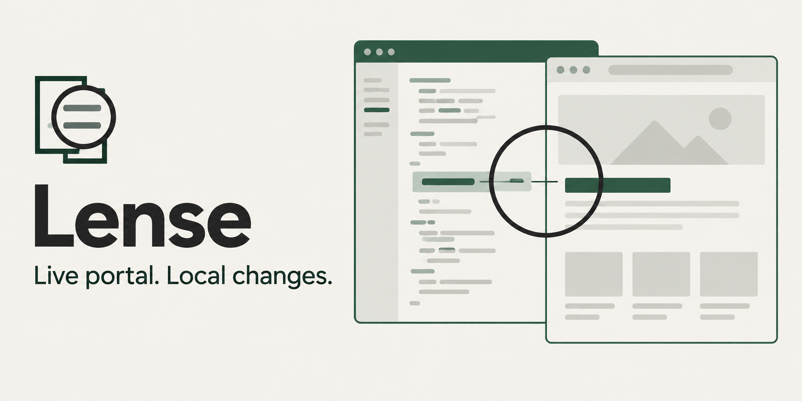

# Lense



Lense provides Power Pages-aware resource overrides for pro-code development. Preview local JavaScript, CSS, images and supported literal HTML edits on a live site; the online backend continues to run Liquid and Dataverse.

For model-driven apps, use the explicit [Solution resource overlay mode](../mirage/docs/model-driven-customizations.md#preview-the-same-code-with-lense). It maps exported JavaScript, PCF bundles and styles to the selected environment's observed resource paths, with applied-response evidence, reload on save and the same Lense panel, X-ray picker and bounded agent/debugger workflow. Its [Actions tab](model-driven-actions.md) adds native inspection, navigation, form workflows, diagnostics, request identity and custom commands. Power Pages keeps the source and Liquid inspection described below.

If you use Fiddler AutoResponder or browser DevTools Local Overrides, Lense adds export-based mappings, record and field identity, Git baseline comparisons and live reload. See the [workflow comparison](../README.md#beyond-fiddler-and-devtools-overrides).

For installation and a first catalogue, follow [getting started](getting-started.md). The examples here run from your portal project with Paqvilo already installed.

## Your edit-preview loop

```sh
# Check the selected target and source mapping offline:
npx --no-install paqvilo lense doctor --config ./paqvilo.config.yml --site portal --env dev

# Open the configured online environment with local overlays:
npx --no-install paqvilo lense dev --config ./paqvilo.config.yml --site portal --env dev
```

1. Sign in through the portal's own sign-in action with your intended account.
2. Open the panel with **Alt+Shift+P** and check the selected site and environment.
3. Save a supported local change. Relevant pages refresh; CSS can hot-swap.
4. Inspect applied resources, diagnostics and failed requests, then switch **Online / Local** to compare responses.

Close the dedicated browser or use Ctrl+C to end the dev session. Browser interactions use the online backend and can affect live data; use authorized environments and actions.

A newly opened tab can load before interception finishes attaching. Lense repairs a clean initial document with
one GET so local sources apply, without replaying a form submission. Edited controls or observed rich-text edits
keep that document open and produce a reload-needed warning; reload manually when the draft is safe to discard.
An older repair cannot replace a newer navigation, including navigation to the same address.

Startup reports configuration, source discovery, process ownership/import, browser/interception setup, document navigation and initial resource/data requests, with a five-second heartbeat and separate command-total and phase elapsed times. Mirage model-driven development also waits for catalogue, staff identity and the initial view before reporting the application usable. Native model-driven overlays finish startup at document load; their workers and background requests can continue, and native app readiness remains unverified. A listening runtime or loaded live-overlay document alone does not establish application readiness; page scripts, sign-in and later application requests can still be pending. Startup failures identify their phase. `mirage start --json` prints its final result on stdout and structured startup events on stderr; `--startup-timeout` bounds discovery, ownership and import (checked between those steps, not as a strict wall-clock deadline). Ctrl+C interrupts pending startup work and stops the owned runtime.

Model-driven Lense has its own [startup deadline and paired local panel workflow](../mirage/docs/model-driven-customizations.md#pair-the-panel-with-a-standalone-local-app). In a multi-tab Power Pages session, failure to install interception on a newly opened target closes only that failed owned tab. An attached-browser target shows an explicit local failure page. Healthy tabs, drafts, source watchers and agent endpoints remain active; open a fresh tab to retry. A lost shared browser connection still ends the session. A failed target is never reported as a working local preview.

## What can I preview?

| Change                                                   | What to expect                                                                          |
| -------------------------------------------------------- | --------------------------------------------------------------------------------------- |
| JavaScript, CSS or an image                              | Browser response overlays from discovered source mappings                               |
| Supported literal HTML or inline fields                  | Baseline patches where the match is unambiguous                                         |
| Liquid logic, server-side settings or Dataverse behavior | Still evaluated by the online portal; use your separate deployment process where needed |
| Exported server-side rendering with local data           | Use [Mirage](../mirage/README.md) to explore supported local simulation                 |

After a save, check **Issues** for changes that require deployment. A changed source whose inline or markup preview is disabled is reported there, even if the page reloads. Reloading alone does not mean an edit was applied.

## Commands at a glance

Run `npx --no-install paqvilo lense --help` for the full command/options reference.
`paqvilo lense doctor --all --mirage --json` gates on Lense, Sources and Mirage readiness.
Duplicate exported YAML keys fail the Sources check without changing the Lense verdict.
Without `--mirage` its exit status covers Lense; source diagnostics remain warnings, and each site line names all three states.
Deployment profile lines list each file relative to the catalogue and its parse readiness.
Add `--lint-profiles` to scan every exported `deployment-profiles` directory for JSON/YAML syntax errors, including unbound files. `profileDiagnostics` contains the source-relative file, parser code, line, column and bound flag. These findings are warnings; selected profile validation still controls Mirage readiness.

| Command                | Purpose                                                                           |
| ---------------------- | --------------------------------------------------------------------------------- |
| `list`, `use`          | Inspect available targets and remember a personal site/environment                |
| `doctor`               | Check configuration, source mapping, Solution inputs and baseline offline         |
| `map`, `resources`     | Discover online-to-local mappings and editable source descriptors                 |
| `audit --all --strict` | Independently inventory exports and expose blocked or unaccounted code            |
| `dev`                  | Open a dedicated browser, apply local overlays and watch saves                    |
| `status`               | Compare local resources with authenticated online responses                       |
| `verify`               | Edit a disposable copy and check the browser applies supported changes            |
| `agent`                | Inspect and control a running owned browser through the bounded authenticated API |

## Source mapping and comparison scope

JavaScript, CSS, images and supported inline fields map from discovered export metadata. Literal markup uses baseline patches and rejects ambiguous matches. Lense does not evaluate Liquid locally or apply server-side portal settings. Enhanced XML and code-bearing YAML fields are edited using their discovered field/JSON descriptors; `source-edit.mjs` preserves sibling values and rejects stale identity or paths outside the source extract.

The default scope overlays every local source. `--scope changed` limits overlays to changes since the captured baseline. HEAD is pinned when a target activates; committing later does not erase the baseline. Explicit deployment refs remain explicit. The panel reports Git drift and can pin a fresh HEAD. Shared sources refresh the affected portal's tabs; page sources affect that page; CSS can hot-swap. Pausing reload preserves an unsaved form while saves accumulate.

Create the initial source commit before previewing literal markup. The [setup instructions](getting-started.md#4-preview-live-with-lense) cover a new export; this local baseline does not identify a deployed commit.

The panel's **Online / Local** switch compares the browser's responses. **Alt+Shift+P** opens the panel. **Alt+Shift+L** hides or shows it; **Alt+Shift+O** switches Online / Local in Lense. **Inspect** is available for live and Mirage sessions. **Tweaks** changes local Mirage identity and scenarios. Independent targets stay isolated by origin, environment and source selection.

In **Inspect**, start with **Page & templates** to explore page copy, JavaScript, CSS and template dependencies. **Forms & controls** connects exported forms, lists, views and fields with rendered controls. **Select an element** picks a node without activating its portal action and opens its evidence in the panel. The selected summary stays available when you switch panel tabs.

### Selection evidence

The same evidence summary appears in the panel and X-ray. **Owner** describes the component established for the selected node; **Local source** describes the admitted source reference. These have separate **Exact**, **Candidate**, **Conflicting**, **Unavailable** or **Stale** states. An exact rendered owner can have an unavailable or stale source. Local matching does not establish the deployed revision.

**Enclosing components** describes containment, **Context** adds observed facts, **Alternatives** keeps other possible matches visible, and **Limits & freshness** reports incomplete searches and evidence gaps. A declared dependency, matching selector or first ranked candidate does not prove element ownership. Asset details distinguish **Served** from **Execution observed** and **Mount observed**; serving a script does not prove that it ran or mounted the selected control.

For a Power Pages field, read the available hierarchy in order: **column → Solution form (FormXml) → table → basic form → host webpage**. Enclosing components opens before Local source so you can see the field's form and table before choosing a file. The selected field and its rendered form receive separate outlines. Each component keeps its own evidence state; a host webpage supplies context without becoming the field's owner. Missing definitions remain unavailable rather than being filled from another form or table with the same field name.

For script-created elements, an observed JavaScript callsite can link the actual node to verified local implementation bytes. The evidence labels **creation**, **clone** and **attachment** separately. Attachment identifies the code that moved or inserted a node; it does not replace that node's original creation source. The link requires the acknowledged response bytes and the browser's actual parsed script version to agree. Serving or parsing code alone does not establish that it executed, and one observed DOM operation does not prove every branch, handler or component mount ran. Anonymous evaluation, custom stack formatting and ambiguous script versions remain unavailable rather than borrowing an older caller's source.

**Open source** uses the admitted semantic source identity and revisions. **Open candidate** explicitly opens a candidate under the same validation. The selected node, source identity and current revisions are checked again before opening. Stale, conflicting and unavailable source actions are disabled. If the source changed, refresh inspection and select again rather than relying on an old line or record. **Copy reference** copies the displayed source reference when an absolute path is unavailable. **Search export markup** offers static suggestions separately; **Browse file** opens their container without asserting an exact rendered source or line.

The final source check runs after the browser confirms the selection. Saving the local file while that browser check
is pending makes the action stale; refresh inspection and select again before opening it.

The one-shot picker retains the actual selected node while X-ray is hidden. If that node is replaced, its frame navigates or its shadow host disappears, the summary clears. Select the new node explicitly; a replacement with the same ID is a new selection. Source refreshes update the retained node's evidence without reopening the panel or moving keyboard focus. **Clear selection** removes the retained selection explicitly.

The inspector does not read input values or page text to build these identities. Selection notifications use opaque document/frame/anchor identifiers; unknown row/user IDs and CSS tokens are excluded.

Use **◎ Lense X-ray** in Inspect, the panel header, or **Alt+Shift+X** to inspect Power Pages sources in place. Hover shows available owner and source evidence; click keeps its details open. Green outlines mark controls, blue marks form/view containers, and amber marks source markup. Colors identify layers, not certainty; read the evidence states for attribution. The layer menu can limit highlights to forms/data, templates/content or the selection. Hold **Ctrl**, or switch to **Interact**, to use the portal; **Inspect** intercepts pointer activation, including over iframe boundaries. The inspector uses the existing Lense panel theme and does not modify portal styles or submit selected controls.

Inspect is modal: while it is on, keyboard (Enter, Space) and pointer activation is intercepted in the page, in every accessible same-origin frame (including frames added or navigated later) and in open shadow roots, so inspecting never activates a portal control. Hold **Ctrl** or switch to **Interact** to use the portal. Cross-origin and sandboxed frames are a boundary: they get no in-frame guards, and when focus moves into one, X-ray reclaims it one task later, so a keystroke in that interval reaches the frame.

**Alt+Shift+X** also activates X-ray while focus is inside an accessible same-origin frame, including nested frames and frames loaded after attachment. Normal typing remains available while inspection is off. Inaccessible frames cannot forward the shortcut; focus the parent document to activate it there.

X-ray opens immediately with a scanning status while local metadata and rendered-element matches load. Its decorative sweep respects reduced-motion preferences; the toolbar stays available to exit or interact with the page. Source identities appear when inspection completes. A failed inspection offers a retry and clears outdated attribution. Cold inspection can take longer on large exports; subsequent inspections reuse the bounded source caches. Panel reads and actions also show pending feedback, and repeated mutation clicks are blocked while the action is running.

The movable card starts with the selected evidence summary, followed by source and page context. **Web API context**, **Page dependencies**, **Page code components** and **Element & ancestry** remain secondary disclosures. Context lists have eight entries per page, with Previous/Next controls; permission and source lists have their own pages. Use **↑ Parent / ↓ Child**, or cycle overlapping elements under the pointer with **[ / ]**. **Reveal** scrolls a selection into view; **Details** hides the card when it covers a target. **Tab / Shift+Tab** visits the inspector's visible controls, including disclosure summaries. Disclosure choices, focus and scroll survive evidence redraws. **Escape** releases a selection, then exits X-ray. Refresh rereads sources and newly rendered component bindings. X-ray is temporary to the current document and is removed when the session detaches.

**Exported code component bindings** includes the declared schema, manifest properties, parameters, native column bindings, portal enablement, resources and datasets. **Exported native controls** and **Exported form / view definitions** keep their configuration relationships visible separately from selected ownership. When no rendered host identifies the component, its exported page references remain under **Page code components**. **Web API context** shows literal or observed entity sets, their exported tables and permission rules. API-derived columns can match custom form identifiers, but remain candidates when the table context is missing. Neither a page reference nor an observed request proves which element owns a request or what access the live user has.

PCF constructor and mount details appear when the runtime actually observes them. A manifest, configured binding, namespace or served bundle does not by itself establish that a particular constructor mounted the selected control. Local definitions and observed local mounts remain separate from the deployed revision, which is unverified without independent evidence.

Field identifiers are checked against the selected export and explicit table context; ambiguous matches stay visible as candidates. Source matching uses static IDs, classes and component attributes without relying on positional DOM paths, so moved regions can keep their source identity. Multiple templates and conditional branches can share markup; matching candidates do not establish a deployed source revision. Related script references and page dependencies remain secondary to the selected element's sources. Accessible same-origin frames support individual control selection with frame-scoped form context and translated, clipped outlines; nested and dynamically inserted or navigated frames are supported. Cross-origin and sandboxed documents remain frame boundaries; open the inner document in its own tab when direct inspection is unavailable. Native dialogs, nested overlays, open shadow roots, scrolling and source-driven DOM replacements are handled without silently transferring a removed selection to another element.

Custom grids can declare their own binding with `data-paqvilo-table="logical_table"` on the table and `data-paqvilo-column="logical_column"` on its cells or headers. For DataTables, X-ray reads declared column `name` metadata (`sName`) and its cell/header indices without invoking renderers or row-data getters. A table declaration supplies its table context; a column name alone retains all matching table candidates. A scroll-head clone can declare `data-paqvilo-grid="original-table-id"` and `data-dt-column` on its headers to use that original grid's declarations. No table ownership is inferred from API requests, cell contents, sibling grids or wrapper proximity. Unknown declared columns remain labelled as declarations whose source definition is unavailable.

Select the field inside an accessible same-origin modal iframe to inspect that document's current form and table, even when the opener's include graph omits the form. Closing, reopening or navigating the modal does not transfer the old selection to a new control. A repeated field name in a different table must resolve against its current rendered component. URL parameters and configured defaults remain context; they do not independently prove ownership. Conflicting rendered form/table declarations remain unresolved, and cross-origin or sandboxed frames remain inspection boundaries.

Attribute-scoped native hosts such as `<logical_column>_ControlView` and `<logical_column>_Container` can carry a known field/form binding through nested same-origin rich-text editor frames. Shared internal editor IDs do not replace that host binding. Record IDs, credentials and editor contents are not needed for this inspection.

X-ray work is bounded so large pages stay responsive. It skips an individual markup source above 1,048,576 UTF-16 code units and reports the omission; discovery and drawing stop at 800 candidate elements and 250 background outlines; details show up to 60 source matches. **Limits & freshness** shows that a search was limited and its omission count before you expand it; its source paths describe index omissions, not sources attributed to the selection. Large pages can therefore show partial background coverage, but selection still inspects the element under the pointer. Closed shadow roots and inaccessible frames are boundaries, and static Liquid matching cannot prove which branch rendered. Missing exports and failed refreshes clear previous identities instead of presenting them as current. Inspection reports are cached and reused until the sources change; the agent API reports omitted sources in `elementSourceLimits`.

Native grids trace their selected views, relationships, action settings and modal forms. Quick views link to their FormXml. Observed Web API requests identify entity sets without collecting record IDs or query values; Solution metadata resolves their table bindings. Exported language routes select the corresponding page and snippet sources. Relative asset references follow their browser URL.

Native code components connect FormXml properties and bound columns to their manifests and portal attribute settings. Inspect distinguishes the selected desktop control from other form factors and reports explicit portal enablement separately from a model-driven default.

Table rows also expose exported Dataverse plugin registrations: message, stage, rank, filtering columns, type and assembly. Open their registration XML or explicitly mapped C# source. Lense uses the online plugin execution; exported registrations do not establish which assembly is currently deployed. See [plugin source mappings](../mirage/docs/dataverse-plugins.md).

With only a portal export, Inspect resolves portal components, snippets, web files and exported access rules. Add `mirage.solutionRoots` or `mirage.project` to the catalogue to resolve Solution FormXml, views, table fields, PCF manifests/resources and literal dataset bindings. Code components resolve by exported schema name or an explicit observed ID mapping. These shared source settings also work in live Lense without starting Mirage. **Refresh inspection** rereads the selected sources, including Solution changes.

**Tables & access** shows exported permissions, scopes, relationships and web roles. Static references can include conditional branches. Rendered controls and assets are labelled separately. Live role membership and effective record access remain unknown; an exported grant is not proof that the signed-in user can use it.

## Automation and evidence

Projects with a [persona catalogue](../mirage/docs/persona-catalog.md) can search and filter
named personas and scenarios in the panel. In live Lense, selection uses the portal's own
sign-in flow; it does not issue native identity tokens for a synthetic contact. In Mirage,
scenarios can open isolated local setups with their own profile, variables and overrides.
**Apply scenario** reveals a confirmation in the panel; review it before confirming the change.
Keep live identity mappings and scenario tests in the project.

Agent discovery files contain bearer tokens and stay under ignored `.paqvilo/agents`. Use `agent sessions` to locate a session; `status`, `pages`, `events`, `state`, `snapshot` and `screenshot` inspect it. Page IDs are different from offline resource IDs. Agent control is origin-confined and has no arbitrary evaluation or proxy endpoint. Consume `nextSequence` and report dropped events.

Inspect applied resources, unmatched markup patches, deployment requirements, errors and failed requests after refresh. Audit coverage reports source classification, not successful navigation or browser application. A sign-in page is not successful target coverage. `verify --signed-in` requires closing the matching dev identity first; headed sign-in can be bounded with `--sign-in-timeout`.

Continue with [configuration](configuration.md), [project extensions](project-extensions.md) or the [documentation index](index.md).

## Agent API reference

Use `paqvilo lense agent <action> --json`. Every page action requires `--session <ignored discovery file> --page-id <numeric ID>`; never print or share discovery contents. The API is confined to its configured portal origin. Attached browsers remain user-owned; stopping an owned target stops its shared owned browser. There is no evaluation, form-action or arbitrary proxy endpoint.

Responses use schemaVersion, command, ok, offline, writesFiles and errors (objects with code/message). Browser inspection has offline=false. Read failures distinguish missing discovery files from invalid JSON. HTTP failures carry stable codes: invalid_argument, invalid_selector, unauthorized, page_not_found, page_busy, session_busy, foreign_origin, origin_changed, unsafe_reload, image_too_large, response_too_large and action_timeout. Messages omit browser stacks, ANSI controls and call logs. The browser navigation deadline is shorter than the CLI HTTP deadline; timed-out navigation is stopped.

### agent sessions

No session is required. Optional --config selects its state folder. Returns sessions with id, site, environment, discoveryFile, reachable, plus invalidFiles and truncated. Does not return bearer tokens. At most 64 files are probed.

### agent status

Returns id, session (without token), readiness, browserScope, access counts, debugger port, baseline, git, overlay, pages and truncation flags. A stopped session's missing discovery file is reported explicitly.

### agent pages

Returns pages with numeric id, document id, sanitized URL, viewport, reload permission and document method. Closed or foreign-origin pages are excluded from actionable pages.

### agent events

Options --after (sequence, default 0) and --limit (1–500, default 100). Returns sessionId, events, oldestSequence, latestSequence, nextSequence, dropped, hasMore and cursorAhead. Advance with nextSequence and inspect dropped/hasMore. A cursor ahead of latestSequence sets cursorAhead=true and resets nextSequence to latestSequence; compare sessionId when reusing a cursor. Retention is 500 events or 1 MiB, whichever is reached first.

### agent state

Returns page, overlay, resources, diagnostics, runtime and limits for the current document. Lists are bounded to 200 items; inspect truncation flags. Page IDs differ from offline resource IDs.

### agent snapshot

Options --selector (CSS, at most 1,000 characters), --limit (1–200, default 100), --styles (up to 20 CSS properties). Returns sanitized URL, title, total, truncated and elements with tag, bounded attributes/text, visibility, rect and style. Does not copy field values. Invalid selectors return invalid_selector (400).

### agent screenshot

Requires --output <new.png>; optional --full-page and --include-panel. Returns path and bytes; writesFiles names the created PNG. Both fields use forward-slash paths relative to the catalogue directory (or working directory without --config). Outside that directory, paths retain `../` segments; on another volume, only the filename is reported. Existing files are never overwritten: an existing output returns `invalid_argument` using the same display rule. Choose a new output filename. PNG output is limited to 8 megapixels, 8,192 pixels per side and 8 MiB.

### agent viewport

Options --width (320–4096, default 1440), --height (240–4096, default 900). Returns page and viewport. Invalid dimensions return invalid_argument.

### agent navigate

Requires --path <portal-path>. Optional --timeout (2000–120000 ms) bounds the client request. Navigate and reload leave a fixed 1000 ms response margin above the browser deadline (whose maximum is 60000 ms). Performs an explicit GET confined to the portal origin and returns page and HTTP status. Foreign origins are rejected; redirects leaving the origin return origin_changed. A browser timeout returns action_timeout (504); transport expiry returns request_timeout.

### agent reload

Optional --timeout. Returns page and status. Only an observed GET document with no pending navigation can reload; unknown, restored-history and POST documents return unsafe_reload (409). Navigation uses an explicit GET to avoid repeating a form post.

### agent stop

Returns stopping=true. For targets sharing one toolkit-owned browser, stopping any target closes that browser and removes every associated discovery file. Independently running sessions and attached user-owned browsers remain intact.

JSON envelopes carry `schemaVersion`, `command`, `ok`, `offline`, `writesFiles` (an array), and `errors` (objects with `code` and `message`). Agent envelopes also carry `action`. Generic CLI errors use `invalid_argument`, `unsupported_option`, `unknown_command`, `configuration_error`, `command_failed`, or `check_failed`; strict inventory failures use `strict_failed` with blocked/gap counts. Domain diagnostics retain their documented runtime codes.

Agent client errors additionally use `session_not_found` (missing discovery file), `invalid_session`, `session_unavailable`, `request_timeout`, `invalid_response`, and `response_too_large`. Server action codes include `invalid_argument`, `invalid_selector`, `action_timeout`, `action_failed`, `page_busy`, `session_busy`, `page_not_found`, `unsafe_reload`, `foreign_origin`, `origin_changed`, `not_found`, `method_not_allowed`, `content_type`, `invalid_json`, `body_too_large`, `image_too_large`, `response_too_large`, `browser_request`, `unauthorized`, `invalid_url`, and `stopping`. HTTP failures retain their status in the error object.

## Local source debugging

By default, Mirage appends file-backed source maps to served JavaScript/CSS assets, including extensionless payloads with those MIME types and model-driven Solution client resources. Page, template, list and form custom JavaScript carries its export sourceURL and line-offset source map. Individual inline blocks use stable `?inline=N` debugger URLs, while maps still point to the original export file. In VS Code, attach to the free port reported by `paqvilo mirage dev --debug-port 9222`:

```json
{
  "type": "msedge",
  "request": "attach",
  "name": "Paqvilo Mirage",
  "port": 9222,
  "resolveSourceMapLocations": ["**", "!**/node_modules/**"]
}
```

The maps contain absolute file URLs, so exported files served below parent routes need no project-specific pathMapping. Set breakpoints in exported source files. Sidecar files and YAML literal blocks retain their source lines; folded/escaped fields and enhanced XML/JSON receive a sourceURL only because their encodings do not preserve JavaScript lines. Liquid expansions that change line counts can shift subsequent locations; the debugger describes rendered JavaScript, not local Liquid execution.

For byte-for-byte asset comparisons, set `mirage.sourceMaps: false` on the catalogue site, or `sourceMaps: false` in a Mirage project, and restart. This disables Mirage's generated debugger trailers. The catalogue's top-level `sourceMaps` and `PAQVILO_SOURCE_MAPS` control Lense overlays separately. See [model-driven debugging](../mirage/docs/model-driven-customizations.md#pair-the-panel-with-a-standalone-local-app) for a panel attached to a standalone local app.

Target selection commits only with Go or Enter. Nonempty local, remote and caution groups are shown; leaving a local runtime for a live target or opening caution requires an in-panel confirmation. Cancel or a failed switch restores the current target. `portals: all` excludes caution targets unless explicitly selected or `includeCaution: true` is set in the catalogue. UI state is scoped to the browser profile, shared across its target switches; a CDP attachment without a known profile keeps UI state in memory. Automated headless sessions start collapsed.

Interactive dev leaves portal `alert`, `confirm`, `prompt` and before-unload dialogs for the browser user to answer. Owned headless dev dismisses alerts, confirms and prompts, and preserves Playwright's automatic acceptance of before-unload dialogs so navigation can complete. Their type, redacted message and disposition appear in Activity and agent events. Attached browsers retain control of their dialogs. This policy also applies when the panel is disabled. Panel controls use their own confirmation UI.

`map --no-write --json` returns the mapping without writing reports. Otherwise writesFiles reports both mapping paths. Resources distinguish exists, empty and renders for optional enhanced fields. Duplicate active page URLs and every overwritten YAML record are diagnosed offline.

Lense JSON commands return a common envelope with schemaVersion, command, ok, offline, writesFiles (an array) and errors (objects with code/message). `status --json` returns comparisons in results, sets offline=false and fails when a comparison is incomplete. `verify --json` reports its final pass/fail after cleanup and names the evidence files it actually wrote. Resource presence and rendering flags describe indexed export relationships; they do not establish browser coverage.

Lense Mirage management uses the same envelope: init names its generated project file; start names state, discovery, ownership and startup log files; stop names its updated ownership file and reports removed discoveries separately. Started runtimes can continue writing state and derived caches. Status/start/stop use offline=false; `lense mirage inspect` is offline and writes no report. Interactive `mirage dev` rejects --json; use start plus the agent API for structured automation.

X-ray matches classes by rarity across the imported export, so common framework classes stay possible matches rather than proof. Static references are labelled separately from rendered provenance. Refresh rescans source stamps and reimports a changed export, so refresh time grows with export size even when one file changed.

Contributors can measure X-ray latency on synthetic exports with `node scripts/benchmark-xray.mjs --samples 3 --strict --json` (run serially). Strict targets: first toggle at most 1,000 ms, revisit below 200 ms, element identification below 5 ms. Results depend on the machine and do not predict every export.
