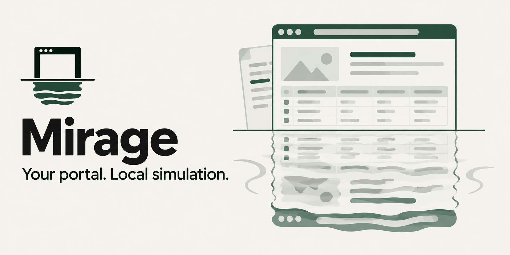

# Mirage



Mirage runs local Power Pages exports, solution-based model-driven apps and a simulated Dataverse organization API. Choose the surfaces your project needs, with independent developer runtimes and repeatable data.

Mirage derives forms, lists, settings and permissions from exported sources and Solution metadata. Your project's registered data packs supply personas, datasets and simulated business rules.

[Interactive demo](../docs/getting-started.md#try-the-demo) | [Configuration](../docs/configuration.md) | [Runtime reference](docs/README.md)

## Start your workspace

For an app or API project without Power Pages, use the [standalone organization guide](docs/standalone-organization.md). It needs Solution exports and optional trusted packs, without a portal export or live environment. [Simulation levels](docs/simulation-levels.md) select memory-only edits, direct pack DATA updates, or schema-capable deep simulation. Configure these in `/_setup/`; changes apply after restart.

Install Paqvilo and configure your export using [getting started](../docs/getting-started.md), then run from your portal project:

```sh
npx --no-install paqvilo mirage init --config ./paqvilo.config.yml --site portal
npx --no-install paqvilo mirage dev --config ./paqvilo.config.yml --site portal
```

Open the panel with **Alt+Shift+P**. **Inspect** connects the current page to its templates, forms, tables, permissions, snippets and settings. **Tweaks** controls your browser's local persona, enforcement and scenarios. Visit `/_sim/` for local administration.

Mirage appends local debugger metadata to exported scripts and stylesheets, including
inline scripts and model-driven client resources. Set `mirage.sourceMaps: false`
on a catalogue site, or `sourceMaps: false` in a Mirage project, to serve their
original asset bytes without generated debugger trailers. This setting takes effect
on restart. The catalogue's top-level `sourceMaps` controls Lense overlays separately.
When using Mirage as a local Lense reference, disabling Mirage maps removes the need
for a trailer-stripping proxy. The runtime still accepts only its listening Host and
registered identity-provider reply origin; arbitrary proxy origins are unsupported.

Open **Model-driven apps** from `/_sim/` or visit `/main.aspx` for the local Power
Pages Management app. It supports grids, saved views, search, filters, columns and
record editing, and loads additional apps/forms/views from solution metadata.
Portal customization edits stay in local runtime state and update the Mirage
preview. See [model-driven apps](docs/model-driven-apps.md) for supported controls,
architecture and limits.

**Backend operations** inventories exported server logic and cloud flows. Review supported defaults, set a JSON response mock or explicitly enable trusted local code. [Operation modes](docs/operations.md) explain the execution boundary. [PCF hosting](docs/code-components.md) covers standard field and explicitly bound dataset controls.

New states contain exported configuration and empty business tables. Use [data scaffolding](../docs/getting-started.md#3-work-locally-with-mirage) for generated rows or a [data pack](docs/data-packs.md) for your own scenarios. The portal starts anonymous; sign in locally before testing protected pages.

## Pick the session that fits

| Command          | Session behavior                                                                                             |
| ---------------- | ------------------------------------------------------------------------------------------------------------ |
| `demo`           | Copy a populated, editable example and open the development browser                                          |
| `init`           | Write a per-site runtime project from your catalogue                                                         |
| `dev`            | Start local runtimes and open the integrated browser; stop newly started runtimes when this dev session ends |
| `start`          | Start owned runtimes in the background                                                                       |
| `status`, `stop` | Inspect or stop background sessions in the same project scope                                                |
| `serve`          | Run a foreground runtime without the integrated browser; stop with Ctrl+C                                    |

```sh
npx --no-install paqvilo mirage status --config ./paqvilo.config.yml --json
npx --no-install paqvilo mirage stop --config ./paqvilo.config.yml --site portal

# Direct foreground runtime without the Lense browser:
npx --no-install paqvilo mirage serve --source ./portal-export --solution-root ./solutions/Core --port 0
npx --no-install paqvilo mirage inspect --source ./portal-export --json
```

Run lifecycle commands with the same catalogue or `--project` used to start the session. A runtime already running before `dev` keeps running when its browser closes. Multi-portal catalogues support one runtime per site and selector navigation; each site has isolated state and a session cookie.

Copy the stop command printed by `start` to stop that runtime. It preserves the selected project or catalogue and any runtime overrides, including port and state selectors for projectless standalone sessions. Ordinary project commands use readable `npx paqvilo mirage stop --project ...` arguments. On Windows, hints work in Command Prompt and PowerShell. Copy them as printed: an encoded `node -e` command preserves unsafe shell characters, a required ownership working directory or a group of separately scoped runtimes.

Large encoded hints can refer to an immutable payload file in the runtime's ownership state directory, normally
under ignored `.paqvilo/`. Keep that file while you need
the printed command. Replay checks the payload size and digest and rejects nonregular files before reading; missing
or changed payloads fail. If a copied hint is no longer usable, use `status` and `stop` with the same project/catalogue
selectors to identify and stop the intended runtime.

Keep the ownership directory and its parents under trusted control during publication and cleanup. Concurrent Paqvilo publishers coordinate their own files; arbitrary replacement by another actor is outside this trust boundary. Portable pathname cleanup is not an atomic compare-and-unlink operation.

If an older session has ambiguous catalogue ownership, use `mirage status` with the same project/catalogue selectors to find its state file and listening port. Supply that `--state` file and actual `--port` when stopping it; port `0` cannot distinguish an older session.

## Build scenarios you can repeat

Use `/_sim/#platform` for simulated Dataverse rules and `/_sim/#overrides` for instance-specific site settings/snippets. Save/import configuration presets and use separate state files to test one source checkout concurrently. See [configuration experiments](docs/configuration-experiments.md) for supported settings, support-managed limits, coverage and APIs.

Local identity comes from a per-runtime cookie. The `_sim` session and Lense Tweaks control
only that browser's identity. [Persona catalogues](docs/persona-catalog.md) add grouped
selection, custom presentation and isolated setups for profiles, variables and overrides.
Use the [public testing API](../docs/public-api.md#test-many-visitors-concurrently) for
independent automated visitors. The [project starter](../examples/project/README.md)
demonstrates an external pack and a test against invented sources.

Large state files use streamed checkpoints and row journals. Read them with the public
`readStateFile` API, and use separate state paths for independent runtimes. See
[state storage](docs/state-storage.md) for persistence, concurrency and memory limits.

## Understand the simulation boundary

Local `_sim` changes affect simulated data, permissions, settings, scenarios and runtime providers. Live-reference reads and cached assets are explicit operations with separate provenance. Live writes remain disabled unless the runtime flag and administration switch both permit them; neither is authorization to perform a business operation.

Local rendering supports selected platform contracts. Review the [coverage matrix](../docs/coverage.md); claim parity only for recorded reference comparisons. See [documentation](docs/README.md) and [project extension guidance](../docs/project-extensions.md).
